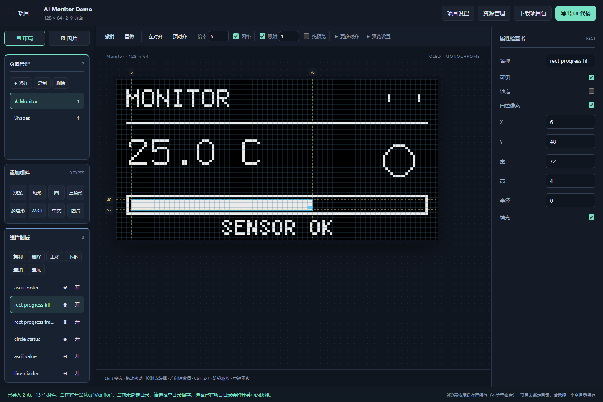
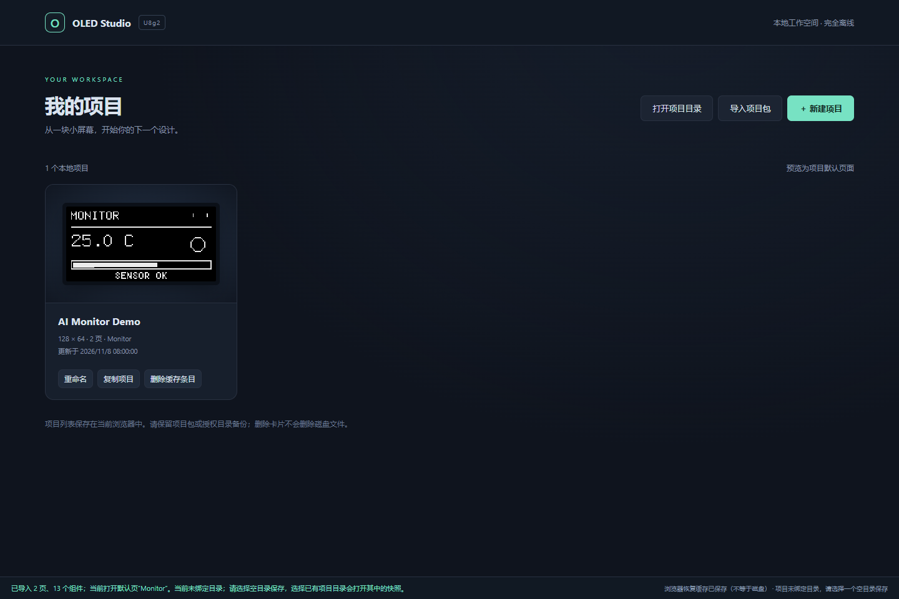
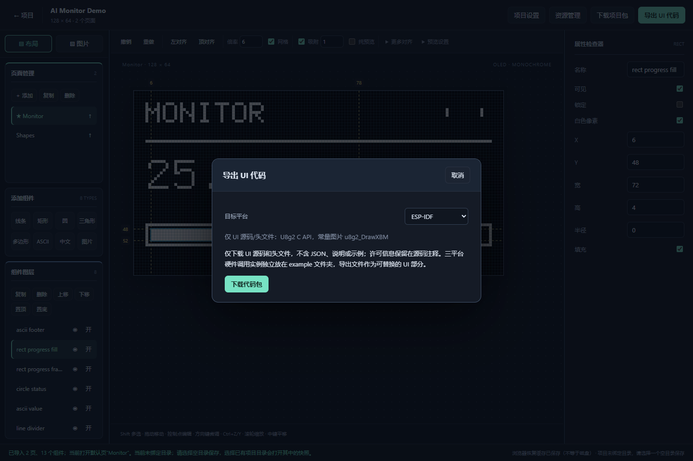

# OLED Studio

**把 OLED 页面设计，从手写坐标变成可视化编辑。**

OLED Studio 是基于 **U8g2** 的单色 OLED UI 设计器。通过拖拽组件、配置属性、生成中文字库和管理位图，设计多页面界面，再导出 Arduino、ESP-IDF 或 STM32 HAL 可调用的 UI 源码。

发布版是一个 **HTML 文件**：用桌面 Chrome / Edge 打开即可使用，无需服务器、账号或网络。预览由真实 U8g2 C/WASM 渲染，不是用浏览器字体模拟 OLED 效果。

[在线运行](https://rou-sir.github.io/oled-ui-designer/) · [开始使用](#快速开始) · [功能概览](#功能概览) · [MCU 示例](example/README.md) · [AI 生成页面](docs/ai-project-guide.md) · [需求与验证](docs/audit.md)
 

## 功能概览

### 项目与多页面

- 卡片式项目首页，展示默认页面的真实预览。
- 新建、导入、复制、重命名和管理多个项目。
- 设置屏幕尺寸、旋转方向、缓冲模式；管理页面顺序和默认页面。
- 页面显示名称可使用中文，独立“代码名称”用于生成可读函数，例如 `home_screen` → `oled_ui_page_home_screen()` / `OLED_PAGE_HOME_SCREEN`。新组件默认命名为 `line1`、`line2` 等，不含空格；已有自定义名称不改。
- 浏览器本地缓存，以及用户授权目录的自动保存。
- 完整项目包包含组件、资源、源图片/字体和转换参数，便于备份与迁移。



### 可视化编辑

- **十六类组件**：点、线条、水平线、垂直线、矩形、圆、椭圆、圆弧、扇形、三角形、多边形、ASCII 文字、中文文字、图片、进度条、电池。
- 进度条支持范围、横向/纵向、边框；电池支持电量和充电标记。圆弧使用 U8g2 256 级角度，扇形使用最多 3° 的三角形分段；预览与导出共享几何规则。
- 组件扩展按阶段交付：当前新增基础绘图与静态状态组件；变量数据结构、动态图表/菜单/二维码、图标库与组合复用尚未交付，不提供运行时事件。
- 拖拽移动、多选、控制点编辑、对齐、层级排序、锁定、复制和撤销/重做。
- 像素网格、吸附、画布缩放、中键平移与四边参考线。
- 页面管理与组件图层独立滚动，左右面板支持拖动调宽。
- 纯预览与自定义亮像素颜色；预览配色不改变单色数据或导出结果。

### 字库与图片资源

| 字库工具 | 图片工具 |
|---|---|
| U8g2 内置 ASCII 字体 | PNG / JPEG / BMP 图片取模 |
| 读取电脑已安装字体或导入静态 TTF/OTF | 裁剪、缩放、阈值、反色与抖动 |
| 按字符子集生成 U8g2 中文字库 | 导入 XBM / C 数组 / 二进制位图 |
| 配置字号、取模阈值，检查缺字 | 取模参数实时预览，独立预览缩放 |
| 真实 U8g2 字库预览，C/BDF 导出 | 手工像素绘制：左键画、右键擦 |

资源管理器分为“图片 / 字库”两个分类，分别搜索和添加；内置 ASCII 字体只在字库分类展示。左侧卡片只显示引用数量，选中资源后在右侧查看可滚动的页面/组件引用明细。从左侧图片面板编辑资源时自动进入图片分类。图片与字库可在项目中复用。手工绘制保存时自动按亮点范围裁剪，无需预先指定图片尺寸。

选择字体文件后，资源名称默认使用不带扩展名的文件名，可自行修改。自定义字库导出符号按资源名称生成，例如 `status_font` → `oled_font_status_font`，不再使用 UUID；空格/连字符转下划线，中文等字符转 Unicode 编码，重名追加序号。字库 C 数据按实际字形记录添加 `/* U+4E2D "中" */` 注释，不改变压缩字节。改名后重新导出，固件中自行引用的旧字库符号需同步修改；内置 U8g2 字体名称不变。

图片同样按资源名称生成，例如 `battery_icon.png` → `oled_bitmap_battery_icon`，三平台源码与独立 XBM 下载一致；XBM 文件名为 `oled_bitmap_battery_icon.xbm`。去除常见图片/数据扩展名，字符转换与重名处理沿用字库规则。改名不改变组件绑定或位图字节，重新导出后自行引用的旧图片符号需同步修改。

导出源码使用 UTF-8，文字直接保留 `"中文"`，不再将中文转换为八进制字节串；仅转义引号、反斜杠与控制字符等 C 字符串语法。编译器源文件及执行字符集需使用 UTF-8（MSVC 可用 `/utf-8`），以匹配 U8g2 DrawUTF8。

## 快速开始

1. 下载仓库中的 [oled-studio.html](dist/oled-studio.html)。在 GitHub 文件页面下载原始文件，**不要将 GitHub 展示页面另存为 HTML**。
2. 用桌面 **Chrome 或 Edge** 打开下载的文件。
3. 新建项目，设置屏幕参数；或导入 [两页示例项目](docs/examples/ai-demo.oled.zip)。
4. 添加组件，调整位置与属性，在资源管理器中加入图片或字库。
5. 下载项目包备份，或授权项目目录自动保存。
6. 点击 **“导出 UI 代码”**，选择目标平台，将源码加入你的固件工程。

> 使用设计器不需要安装 Node.js、Python 或 MCU 编译环境。目录保存和电脑字体读取需要浏览器支持，并由你明确授权。

### GitHub 在线版与离线发布

GitHub Pages 部署启用后，在线设计器地址为：
https://rou-sir.github.io/oled-ui-designer/
这是浏览器端静态应用，项目仍保存在本地浏览器或用户授权目录，不会上传至 GitHub。在线域名与离线 HTML 的浏览器缓存相互独立；切换使用方式请通过项目包迁移。

[Releases](https://github.com/Rou-sir/oled-ui-designer/releases) 提供单 HTML 和离线 ZIP。ZIP 包含设计器、第三方许可及三平台集成示例，解压后打开 `oled-studio.html`。MCU 示例仍由使用者自行测试。

维护者发布步骤：

1. 将项目推送到 `Rou-sir/oled-ui-designer` 的 `main` 或 `master` 分支。
2. 在仓库 **Settings → Pages → Build and deployment → Source** 选择 **GitHub Actions**，启用 Actions 后运行 `Publish OLED Studio` 工作流。
3. 提交前重新构建并验证，提交已生成的 `dist/oled-studio.html` 和许可文件。工作流部署这份已验证的成品，不在 CI 安装 MCU 工具链。
4. 推送版本标签（例如 `v0.1.0`），自动创建 Release，附上 `oled-studio-v0.1.0.zip` 和 `oled-studio.html`。已有同名标签/Release 不会自动覆盖。

本地仅打包可运行 `python scripts/package_release.py v0.1.0`，输出在忽略提交的 `release/`。

### 常用操作

| 操作 | 快捷键 / 方式 |
|---|---|
| 保存项目 | `Ctrl+S` |
| 撤销 / 重做 | `Ctrl+Z` / `Ctrl+Y` |
| 复制 / 粘贴组件 | `Ctrl+C` / `Ctrl+V` |
| 多选 / 微调 | `Shift` 多选 / 方向键 |
| 放大 / 平移画布 | 鼠标滚轮 / 中键拖动 |
| 调整面板宽度 | 拖动分界条；双击恢复默认 |

## 导出到 MCU

导出的 ZIP **只包含 UI 源码与头文件**，不包含 JSON、README、驱动或示例工程；许可信息保留在源码注释。

| 目标平台 | 页面源码 | 原生调用 | 图片存储 |
|---|---|---|---|
| Arduino | `oled_ui.cpp` | `display.drawXBMP()`、`display.drawUTF8()` 等 | `U8X8_PROGMEM` |
| ESP-IDF | `oled_ui.c` | `u8g2_DrawXBM()`、`u8g2_DrawUTF8()` 等 | 普通常量数组 |
| STM32 HAL | `oled_ui.c` | U8g2 C API，HAL 用于设备回调 | 普通常量数组 |

UI 接收已初始化的 U8g2 实例。`oled_ui_draw` 只绘制页面，调用方负责初始化、缓冲循环和刷新。

```cpp
// Arduino：已初始化的全缓冲 U8G2 实例
#include "oled_ui.h"

display.clearBuffer();
if (oled_ui_draw(display, OLED_UI_DEFAULT_PAGE)) {
    display.sendBuffer();
} else {
    // 在应用中处理无效页面。
}
```

独立的 [example 目录](example/README.md) 提供 SSD1306 128×64、I2C 地址 `0x3C` 的调用实例：

- [Arduino Uno](example/arduino/oled_example/oled_example.ino)：SDA=A4，SCL=A5。
- [ESP32 / ESP-IDF 5.2+](example/esp-idf/main/main.c)：SDA=21，SCL=22，新 I2C master API。
- [STM32 HAL](example/stm32-hal/oled_example.c)：使用 `hi2c1`，时钟/GPIO/I2C 由 CubeMX 工程初始化。

示例是固定的硬件/应用部分，导出文件是可替换的 UI 部分。更新导出包时先移除旧 UI 文件，避免同时编译旧 C 页面和新 Arduino C++ 页面。

> UI 与 U8g2 库必须一致启用 **`U8G2_16BIT`**。全缓冲与页缓冲刷新方式不同，请按实际配置调用。独立硬件示例尚未完成实际 SDK 编译和硬件验收，需在你的环境中测试。



## 保存与迁移

- **浏览器缓存**：方便继续编辑，但不是磁盘备份；更换浏览器或清理浏览器数据可能丢失缓存。
- **授权目录**：自动写入 `project.oled.zip`，只有文件关闭写入成功才显示磁盘已保存。重新打开时可能需要重新授权。
- **项目包**：可下载并重新导入，包含恢复设计所需的数据；与 MCU 源码包用途不同。

导入项目包是恢复完整快照，不是合并。相同项目 ID 的导入保留已有目录绑定，不同项目会解绑；选择已有项目目录会打开目录中的项目。删除首页缓存卡片不会删除磁盘文件。

建议保留独立项目包备份，避免在多个窗口同时编辑同一磁盘项目。

## 让 AI 直接生成页面

项目采用版本化 JSON 清单与二进制资源封装。其他 AI 可以按照规范生成项目，再导入设计器继续编辑。

- [项目格式、组件坐标与调用说明](docs/ai-project-guide.md)
- [两页示例 JSON](docs/examples/ai-project.json)
- [Python 标准库打包工具](docs/examples/pack_ai_project.py)
- [可直接导入的示例包](docs/examples/ai-demo.oled.zip)

## 本地开发

源码使用 TypeScript、esbuild 与 U8g2 C/WASM。当前构建脚本面向 Windows。

开发环境：Node.js、Python、Git、curl、Visual Studio C++ Build Tools；原生构建需要 Emscripten。工具准备脚本会下载依赖，请按需执行，**使用发布 HTML 不需要这些工具**。

```powershell
# 首次准备开发工具和原生运行时
.\tools\bootstrap.ps1
$env:Path = "$(Get-Location)\.tools\node-v24.11.0-win-x64;$env:Path"
npm ci
.\tools\run.ps1 -Task build-native

# 构建单文件发布版与运行单测
.\tools\run.ps1 -Task build
.\tools\run.ps1 -Task test
```

浏览器回归使用已安装的 Chrome，其他路径可通过 `CHROME_PATH` 指定。资源测试需要先准备测试字体：

```powershell
.\scripts\fetch-test-fonts.ps1
$env:STUDIO_SKIP_MCU_BUILD = '1'
.\tools\run.ps1 -Task test-studio
```

上述模式验证网页与导出包，不执行 MCU 编译。完整测试还包括目标工具链编译与 AVR 指令级像素对照，需另外准备相应环境；验证范围见 [审计记录](docs/audit.md)。

| 目录 | 内容 |
|---|---|
| [src](src) | 设计器、资源工具与代码生成 |
| [native](native) | U8g2 原生渲染与验证代码 |
| [dist](dist) | 可直接打开的 HTML 与依赖许可 |
| [example](example) | 三平台独立硬件调用示例 |
| [docs](docs) | 需求、验证、AI 项目规范及截图 |
| [tests](tests) / [scripts](scripts) | 单元测试、构建与浏览器回归 |

## 当前边界

- 面向 **单色静态 UI**，不提供事件绑定、动画、运行时数据绑定或完整驱动工程。
- 中文文本使用 **UTF-8**，字库支持源字体覆盖的 Unicode BMP 字符；不支持非 BMP 生僻字、彩色 emoji 或复杂 shaping。
- 自定义字体支持静态 TTF/OTF；电脑字体接口返回的 TTC 可提取所选成员，不支持直接导入 TTC 集合或可变字体。
- ASCII 内置字体按 U8g2 原生尺寸显示，不做任意字号缩放。
- 图片/画布每边支持 1–512 像素；资源字节数不代表完整固件的 Flash/RAM，尤其应检查 AVR 的内存预算。
- 自动化编译与像素对照不等于真实 OLED 硬件测试；浏览器授权能力与行为取决于实际环境。

## 第三方许可

U8g2 使用 BSD-2-Clause，字体和图片可能有各自的许可。发布目录保留 [U8g2](dist/U8g2-LICENSE.txt)、[opentype.js](dist/opentype-LICENSE.txt) 与 [fflate](dist/fflate-LICENSE.txt) 的许可证；使用或分发资源前请核对其授权。

截图由实际离线设计器运行生成，展示仓库内的 AI Monitor Demo 示例，不包含用户项目或系统字体资源。
